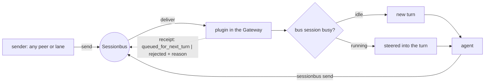

# Sessionbus OpenClaw peer

[](https://github.com/imortkz/openclaw-peer/actions/workflows/ci.yml)
[](https://github.com/imortkz/openclaw-peer/actions/workflows/release.yml)
[](https://github.com/imortkz/openclaw-peer/releases)
[](LICENSE)
<br>
[](#verified)
[](#verified)

Connect OpenClaw agents through [Sessionbus](https://github.com/antst/sessionbus): an OpenClaw plugin puts
the agents you enable — any number per Gateway — on the bus as **peers**, and a Go worker runs allowed agents
headless as **lanes**.
Both keep OpenClaw's own tools, permissions, sessions and runtimes (embedded, codex, claude-cli).

An enabled agent is a full Sessionbus peer, on the same footing as `claude-peer` or `codex-peer`:

- it talks to any peer it shares a group with — `list`, `send`, and replies to whoever wrote to it;
- it starts and drives lanes itself, on its own host or any other host of the federation — `spawn` (with `host`),
  `start`, `wait`, `ack`, `close` — whatever product that host offers;
- its own host offers `openclaw-peer` lanes: other peers can run the agents you list in `lanes.agents`, with any
  model those agents are allowed to use (see [`describe`](#what-describe-shows-other-peers)).

## Prerequisites

- Linux or macOS (amd64, arm64)
- OpenClaw ≥ 2026.8.2 and the Node version that release requires; peers are verified up to 2026.9.8, lanes up to
  2026.10.9 ([Verified](#verified))
- Sessionbus 0.5.12, running under the same OS user as the OpenClaw Gateway

## Install

```sh
curl -fsSL https://raw.githubusercontent.com/imortkz/openclaw-peer/main/scripts/install.sh | sh
```

The installer takes the latest release (`OPENCLAW_PEER_VERSION=v0.2.1` pins one), checks its checksum, installs
the lane worker as `~/.local/bin/openclaw-peer` and puts the plugin package beside it. It changes nothing else and
prints the remaining steps: install the plugin into OpenClaw, restart the Gateway, and — for lanes — add
`openclaw-peer` to `SESSIONBUS_PRODUCTS` in the Sessionbus `service.env`.

## Quick start

Enable the bus channel and the agents you want on the bus in `openclaw.json`, then restart the Gateway. Here it is
OpenClaw's default agent `main`; add more entries under `agents` the same way:

```json5
{
  channels: { sessionbus: { enabled: true } },
  plugins: {
    entries: {
      sessionbus: {
        config: {
          agents: {
            main: { enabled: true, groups: ["home"] }, // a peer; add more agents here
          },
          lanes: { // optional: agents callers may run as lanes
            agents: { main: { description: "General assistant" } },
            credentialDir: "/srv/openclaw/lane-cli",
          },
        },
      },
    },
  },
}
```

Any Sessionbus session started in group `home` (`-g home`) now sees `main` and can `send` to it. Agents on the
`coding` or `messaging` tool profile also need `tools: { alsoAllow: ["sessionbus"] }`. All options, several agents
on one Gateway, the session key and lane pairing: [the plugin guide](docs/GUIDE.md#configure) and
[the lane guide](lane/README.md).

## How it works

| | Peer | Lane |
|---|---|---|
| What runs | the agent in the Gateway, always on the bus as `<name>@<host>` | a headless run of an allowed agent, started by a caller |
| Started by | the plugin, at Gateway start | a caller's `spawn` with `product: "openclaw-peer"`, `--agent <id>` |
| Talks | receives messages, replies with its `sessionbus` tool | `start` / `wait` / `ack` / `close`, like any Sessionbus lane |
| Parts | plugin | worker `openclaw-peer` (ACP to the Gateway) + plugin bridge socket |

### A message to a peer



- Each message lands in a **bus session** of the agent, separate from the owner's Telegram or main session. Bound
  to that session, bus messages would be mixed into the turn the owner is having with the agent (and the owner's
  Telegram messages into bus work). Separate sessions keep the two conversations apart; how the agent should
  treat the bus and the human — what to report, what to ask — is yours to put in its instructions.
  `busSessionBinding` picks which bus session:

  | `busSessionBinding` | one bus session per | key |
  |---|---|---|
  | `name` (default) | sender name — a restarted peer keeps its context | `agent:<id>:sessionbus:direct:<name>` |
  | `sessionId` | sender session | `…:direct:<session_id>` |
  | `singleton` | agent | `…:direct:%all` |

- A running turn gets the message steered in, except on `claude-cli` (see below).
- The agent's final text goes nowhere: it answers only with `send` to the sender. Bus text is never run as an
  OpenClaw command.
- `connected` / `running` in a roster mean bus attachment and a managed run, not that the model is idle.

### What `describe` shows other peers

Any peer can ask a host what its `openclaw-peer` lanes accept, before spawning one:

```json
{"action": "describe", "arguments": {"product": "openclaw-peer", "host": "<host>"}}
```

The answer lists the open fields a lane takes (`cwd`, `permission_mode`, `model`, `reasoning_effort`, `arguments`)
and one extra argument, `--agent`, whose description is the lane menu of that host:

```text
OpenClaw agent for this lane, required: main — General assistant [models: openai/gpt-6-sol,
openrouter/qwen/qwen3.7-flash, anthropic/*; default: openai/gpt-6-sol]; reviewer — Review agent [models: any;
default: anthropic/claude-opus-5]
```

- **Agents** — the ids in `lanes.agents` with your one-line descriptions. With one agent it is the default and
  `--agent` may be omitted; with several, `--agent <id>` is required.
- **Models** — each agent's allowlist exactly as OpenClaw's model policy has it (wildcards and aliases unexpanded,
  `any` when the agent has no allowlist), the first 20 entries then `… +N more`, and the model OpenClaw resolves by
  default for that agent. Pick one with `open.model` (`provider/model`, nested refs like
  `openrouter/qwen/qwen3.7-flash` too); a model outside the allowlist is refused with the full list and the default.
- **Freshness** — the menu is read when the Gateway starts; after changing an agent's model policy, restart the
  Gateway to refresh `describe`. The model check on spawn always uses the live policy.
- If the plugin is not reachable, `describe` still answers and the description says `lane settings unavailable: …`.

### A lane across a Gateway restart

A Gateway restart ends the lane's OpenClaw session, including a turn in progress. The lane keeps its results:
`status` / `wait` / `ack` still return them until the lane closes by `auto_close_ms`, its owner leaving, or `close`.
A turn the restart cut short ends `unavailable` with the reason (`acp child exited: …`); its answer never existed.
New runs on that lane are refused (`lane bridge lost` or `lane native session exited`), and a refused run clears the
automatic-close timer, so close the old lane and spawn a new one.

Details: [the lane guide](lane/README.md#losing-the-bridge).

### Runtimes and a message during a turn

What happens to a message that arrives while the agent is working depends on the OpenClaw runtime of its model:

| Runtime | Message during a turn | Verified live |
|---|---|---|
| embedded (OpenClaw's own loop, API providers) | steered into the running turn; the model sees it after its current tool call returns | 2026.9.8, OpenRouter `qwen/qwen3.7-flash`: peer wake, reply, mid-turn steer, lane run |
| codex | steered into the running turn | 2026.8.2 and 2026.9.8: codex peer and codex lane |
| claude-cli | **not steered**: OpenClaw cannot feed a running `claude-cli` turn, so the message waits and runs as the next turn, without loss | 2026.8.2 and 2026.9.8: next-turn delivery |

On `claude-cli` an agent busy with a long task therefore sees bus messages only when the task ends. Use an
embedded or codex model for agents that must react mid-task.

### `/sessionbus` in chat

The owner can look at the bus from the agent's chat (Telegram or any channel) without a model turn:

| Command | Shows |
|---|---|
| `/sessionbus` | a button menu (plain text where buttons are not supported) |
| `/sessionbus roster` | who this agent sees on the bus: host, kind, state, product, name; the agent is marked `(self)` |
| `/sessionbus status` | the agent's bus id, name, groups, connection, OpenClaw and plugin versions |

Owner only (`commands.ownerAllowFrom`). If another host is asleep, the answer after 5 s covers this host and says so.
Details: [the plugin guide](docs/GUIDE.md#chat-command).

## Build and test

```sh
npm ci && npm test
cd lane
export GOWORK=off GOFLAGS=-mod=vendor
go test -race ./... && go vet ./...
```

The worker builds with Go 1.24 from vendored modules, no network. CI runs both suites on Linux and macOS and a plugin
security scan; releases are cut from `vX.Y.Z` tags matching [`RELEASE_VERSION`](RELEASE_VERSION).

## Verified

Docker smokes ([peer](smoke/docker/README.md), [lane](smoke/docker/lane/README.md)) pass on OpenClaw 2026.8.2 and
2026.9.8. The lane smoke restarts the Gateway during and after a run and checks that results stay readable; it also
passes on 2026.10.9. The peer smoke does not pass on 2026.10.9 yet: peers on OpenClaw 2026.10 are not supported in
this release. Live runs on a real install are listed per runtime in [Runtimes](#runtimes-and-a-message-during-a-turn).
Conformance table: [the plugin guide](docs/GUIDE.md#conformance-with-sessionbus-0512-busy-mid). Architecture:
[docs/ARCHITECTURE.md](docs/ARCHITECTURE.md).

## License

[MIT](LICENSE)
